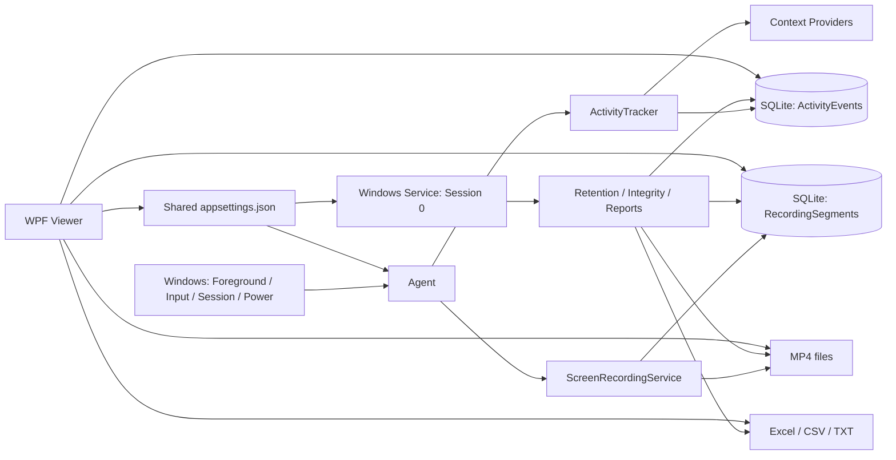

# تحليل ActivityMonitor

> هذا تقرير ما قبل الإصلاح. الحالة الحالية موثقة في [سجل الإصلاحات](FIXES_2026-10-15.md).

تاريخ المراجعة: 15 أكتوبر 2026. النطاق: النسخة الموجودة في مجلد العمل، بما فيها التعديلات المحلية والملفات غير المتتبعة، وليس آخر commit وحده.

## 1. الحكم العام وحدود الإثبات

المشروع يملك أساسًا عمليًا جيدًا لتطبيق مراقبة محلي على Windows: فصل بين Agent تفاعلي وخدمة صيانة، قاعدة SQLite، تسجيل مقسّم، تقارير متعددة الصيغ، وعارض عربي. بناء Release ينجح، والاختبارات الحالية تمر. لكن النسخة الحالية تحتاج معالجة مشكلات سلامة البيانات وعزل الجلسات والصلاحيات قبل اعتمادها في تشغيل مؤسسي مستمر، خصوصًا على أجهزة يتشاركها أكثر من مستخدم.

هذه النتيجة مبنية على قراءة المصدر وتشغيل البناء والاختبارات وست تجارب لإعادة إنتاج عيوب في بيئة معزولة. لم أشغّل Agent فعليًا، ولم ألتقط شاشة أو صوتًا، ولم أقرأ بيانات النشاط الفعلية، ولم أغيّر خدمة Windows أو مهام بدء التشغيل أو إعدادات الجهاز. لذلك لا يشمل الإثبات جودة فيديو حقيقية، توافق الأجهزة، أو قياسات أداء لساعات متواصلة. لم أعدّل ملفات التنفيذ الأصلية؛ الإضافات تخص هذا التقرير وبرنامج التشخيص ونتائجه فقط.

| التحقق المنفّذ | النتيجة |
|---|---|
| `dotnet build ActivityMonitor.slnx -c Release --no-restore --verbosity minimal` | نجاح المشاريع السبعة، صفر أخطاء وصفر تحذيرات |
| `dotnet test ActivityMonitor.slnx -c Release` | 62 حالة: 59 ناجحة، 3 متجاوزة، صفر إخفاقات |
| فحص NuGet مع `--vulnerable --include-transitive` | لم يبلغ الفحص عن حزم ضعيفة معروفة في المصادر المستخدمة وقت الفحص؛ ليس ضمانًا شاملًا للأمان |
| برنامج التشخيص المعزول | ست حالات خلل معاد إنتاجها، وفحص إضافي يثبت غياب SessionId من عقد البحث عن المقطع الجاري |
| قياسات CPU / RAM / GPU / Disk وتشغيل تسجيل حقيقي | غير منفّذة؛ لا يصح استنتاجها من نجاح البناء أو الاختبارات |

نتائج الاختبارات: [analysis-release.trx](C:/Users/Masoud/source/repos/ActivityMonitor/scratch/analysis-results/analysis-release.trx). نتائج التجارب: [probe-results.json](C:/Users/Masoud/source/repos/ActivityMonitor/scratch/analysis-probes-20261015/probe-results.json).

## 2. البنية ومسار العمل



| المشروع | المسؤولية الفعلية | التقييم |
|---|---|---|
| Core | الكيانات والعقود والحسابات وخيارات الإعداد | فصل مناسب، لكن المسارات العامة القابلة للتغيير تمثل حالة مشتركة تحتاج ضبطًا |
| Infrastructure | EF Core وSQLite والمستودعات وسلامة الملفات والتخزين والسياق والسجل | يجمع أعمالًا متعددة، لكنه واضح نسبيًا؛ أهم مخاطر الاتساق موجودة هنا وعند حدود Agent |
| Agent | التتبّع والتسجيل وأحداث الجلسة والطاقة وبدء التشغيل | أكثر المكونات حساسية؛ يجمع عدة خيوط وأقفال وعمليات خارجية |
| Reporting | إنشاء Excel وCSV وTXT | إخراج غني وحفظ ذري؛ منطق ربط الفيديو مكرر |
| Service | صيانة وتدقيق واستبقاء وتقارير | الفصل عن الشاشة في Session 0 قرار صحيح؛ الإقلاع يؤدي أعمالًا كثيرة قبل اكتماله |
| Viewer | عرض عربي RTL، مشغل، مؤشرات، إعدادات، تحكم بالخدمات | وظيفة واسعة، مع اعتماد مباشر على البيانات وWindows وتكرار لمنطق المجال |
| Tests | وحدات واختبارات SQLite وواجهة وتخطيط | أساس مفيد، لكن تغطية حالات فشل Agent والتزامن ضعيفة |

الاعتماد على Core في الأطراف مناسب. وصف «Clean Architecture» هنا جزئي: لا توجد طبقة Application/Use Cases واضحة، وViewer ينشئ DbContext مباشرة، وReporting يعتمد على Infrastructure. هذا مقبول لحجم التطبيق الحالي، لكنه يرفع تكلفة تغيير التخزين والسياسات واختبار الوظائف بمعزل عن Windows.

إحصاء الملفات المصدرية `.cs` و`.xaml`، بعد استبعاد bin وobj: 73 ملفًا و15,932 سطرًا، تشمل التعليقات والتنسيق. نحو 5,879 سطرًا في Viewer و3,204 في Agent. يصل كل من ActivityTracker وMainViewModel إلى 1,357 سطرًا؛ هذه إشارة إلى تراكم مسؤوليات، وليست وحدها دليلًا على عيب وظيفي.

## 3. النتائج ذات الأولوية العالية

P1 تعني أولوية عالية بسبب إمكانية فقد بيانات أو كشفها أو ربطها خطأ. P2 تعني خللًا أو خطرًا تشغيليًا مهمًا يعتمد أثره على سيناريو الاستخدام. التصنيف تقدير هندسي داخل المشروع، وليس درجة CVSS.

### A01 — P1: جميع المستخدمين المحليين يستطيعون تعديل البيانات والتسجيلات

**الدليل:** [Install.ps1:60](C:/Users/Masoud/source/repos/ActivityMonitor/deploy/Install.ps1:60) يمنح مجموعة Users القراءة على الجذر، ثم يمنحها Modify موروثة على Data وRecordings وLogs عند الأسطر 65–66.

**الأثر:** يستطيع المستخدم المحلي الوصول إلى قاعدة النشاط وتسجيلات المستخدمين الآخرين، وتعديل أو حذف السجلات والتسجيلات والسجلات التقنية. عدم إنشاء اختصار للعارض لا يشكل تحكمًا بالوصول. البيانات لا تصلح بهذه الصلاحيات كسجل موثوق مقاوم للعبث. الخدمة تنشأ دون تحديد حساب مخصص، ما يجعل حدود الثقة بين خدمة ذات صلاحيات مرتفعة وبيانات قابلة للتعديل بواسطة Users موضوعًا يحتاج تشديدًا.

**المعالجة:** تحديد نموذج التفويض أولًا: حساب خدمة محدود، مجموعة مراجعين مخولة، وفصل بيانات كل مستخدم أو جلسة. إن كان يلزم منع المستخدم من تعديل السجل الذي يكتبه Agent، فالأفضل أن يرسل Agent البيانات إلى خدمة كاتبة عبر IPC محلي مصادق عليه، بدل إعطاء الجميع حق تعديل قاعدة مشتركة. تحتاج الحماية الفعلية أيضًا سياسة وصول للتسجيلات والتقارير، لا قفل واجهة فقط.

**مستوى الإثبات:** مؤكد من سكربت التثبيت؛ لم أشغّل التثبيت أو أغيّر ACL الفعلية.

### A02 — P1: ربط الفيديو والاسترداد لا يعزلان جلسات المستخدمين

**الدليل:** [RecordingLocatorService.cs:64](C:/Users/Masoud/source/repos/ActivityMonitor/ActivityMonitor.Infrastructure/Services/RecordingLocatorService.cs:64) يمرر MachineId والزمن دون SessionId. [RecordingRepository.cs:125](C:/Users/Masoud/source/repos/ActivityMonitor/ActivityMonitor.Infrastructure/Repositories/RecordingRepository.cs:125) يبحث عن المقطع الجاري للجهاز كله. كذلك BuildRecordingParts داخل Viewer يطابق بالزمن، وResolveRecordingLocations داخل Reporting يفعل الشيء نفسه.

**إعادة الإنتاج:** نشاط Session 1 أعاد مقطع Session 2 على الجهاز نفسه. كما غيّر استدعاء RecoverOrphanedSegmentsAsync حالة مقطع لجلسة مختلفة من InProgress إلى Completed، دون التحقق من أن منتجه توقف فعلًا.

**الأثر:** مراجعة فيديو مستخدم آخر، تكرار أجزاء متداخلة، إحصاءات تجمع جلسات متعددة تحت اسم مستخدم واحد، واعتبار تسجيل يعمل في جلسة ثانية تسجيلًا مهجورًا. بعد تغيير الحالة قد يصبح ذلك الملف مؤهلًا للصيانة أو الحذف رغم استمرار كاتبه.

**المعالجة:** إدخال هوية ثابتة للمستخدم، وSessionId، ومعرّف لنسخة Agent في عقود الاستعلام والاسترداد. اعتماد heartbeat/lease لإثبات أن المقطع لم يعد مملوكًا لعملية حية. SessionId وحده قد يُعاد استخدامه، لذلك لا يكفي كهوية تاريخية. مشاركة التقرير على مستوى الجهاز يجب أن تكون خيارًا صريحًا مع إظهار المستخدم والجلسة.

### A03 — P1: فشل إدراج حدث واحد قد يفقد بقية نشاط السياق نفسه

**الدليل:** [ActivityTracker.cs:929](C:/Users/Masoud/source/repos/ActivityMonitor/ActivityMonitor.Agent/Tracking/ActivityTracker.cs:929) يضع الحدث في `_currentActivity` قبل نجاح AddAsync عند السطر 948. عند الفشل يبقى الحدث بمعرّف صفر؛ العينات اللاحقة المطابقة تسلك مسار UpdateAsync عند السطر 879، بينما الإنهاء لا يحفظه إلا إذا كان Id أكبر من صفر عند السطر 1017.

**إعادة الإنتاج:** حقنت فشل IOException في الإضافة الأولى، ثم أرسلت عينة مطابقة. النتيجة: محاولة إضافة واحدة فقط، تلتها محاولة تحديث Id=0. لا توجد إعادة إدراج.

**الأثر:** التطبيق يواصل العمل ظاهريًا لكن النشاط في ذلك السياق غير محفوظ. تسجيل الخطأ في log لا يسترد الحدث.

**المعالجة:** حالة صريحة للأحداث غير المحفوظة، مع إعادة محاولة إدراج وتحديثات idempotent، أو طابور كتابة محدود ذي سياسة استرداد. لا تنشر الحدث كأنه محفوظ قبل نجاح العملية. الاختبار المطلوب يمر عبر ActivityTracker الحقيقي مع فشل مستودع مؤقت، ثم يتحقق من حفظ النشاط بعد التعافي.

### A04 — P1: حفظ إعدادات الفيديو يختصر الاحتفاظ بسجل النشاط دون إعداد مستقل

**الدليل:** [SettingsService.cs:254](C:/Users/Masoud/source/repos/ActivityMonitor/ActivityMonitor.Viewer/Services/SettingsService.cs:254) يضبط `Storage.RecordingRetentionDays` و`Storage.ActivityRetentionDays` على قيمة `model.RetentionDays` نفسها. الافتراضات الأصلية 14 يومًا للفيديو و90 يومًا للنشاط.

**السيناريو:** يفتح المسؤول الإعدادات لتغيير جودة الفيديو ثم يحفظ مع القيمة الافتراضية 14. يصبح احتفاظ النشاط 14 بدل 90. دورة الصيانة التالية تنفذ الحذف وفق الإعداد الجديد.

**الأثر:** فقد تاريخ نشاط أقدم من أسبوعين دون وجود تحكم مستقل واضح في هذا التاريخ.

**المعالجة:** فصل مدد الاحتفاظ بالفيديو والنشاط والتقارير والسجل. عدم تعديل إعداد غير معروض أو لم يتغير. عرض الأثر المتوقع قبل أي تقصير في الاحتفاظ، وإضافة اختبار round-trip لحفظ إعداد جودة الفيديو مع بقاء مدد السياسات الأخرى كما هي.

## 4. عيوب الدقة والاعتمادية

### A05 — P2: التسجيل الجاري يبدو كأنه بطول ثانية واحدة

[RecordingLocatorService.cs:70](C:/Users/Masoud/source/repos/ActivityMonitor/ActivityMonitor.Infrastructure/Services/RecordingLocatorService.cs:70) و119 يحسبان نهاية المقطع المفتوح من `StartedAtUtc + Max(1, DurationSeconds)`. المقطع يبدأ بمدة صفر، ولا توجد نبضة دورية لتحديث مدة التسجيل الجاري. Viewer وReporting يكرران المنطق نفسه.

**إعادة الإنتاج:** مقطع InProgress يبدأ عند 10:00:00؛ البحث عن 10:00:30 يعيد صفر أجزاء. لذلك قد لا يظهر الفيديو للنشاط الحالي حتى ينتهي المقطع. يلزم حساب حد زمني للمقطع الجاري من heartbeat/زمن آخر إطار مؤكد، وفصل المقاطع المكتملة عن الجارية في سياسة البحث.

### A06 — P2: استرداد MP4 يعتمد على الحجم فقط ويُنتج حكم سلامة مضللًا

[ScreenRecordingService.cs:789](C:/Users/Masoud/source/repos/ActivityMonitor/ActivityMonitor.Agent/Recording/ScreenRecordingService.cs:789) يعتبر الملف أكبر من 2,048 بايت Completed. **أعدت إنتاج ذلك بملف مكوّن من 4,096 بايت صفرية، فصار Completed.** لا يوجد تحقق من بنية MP4 أو قابلية فك الترميز.

خدمة DataIntegrity أكثر تحفظًا، إذ تضع المقطع المهجور في Corrupted، لكن سلوكي الاسترداد متناقضان. المطلوب توحيد الاسترداد، وفحص الوسائط فعليًا، وتمييز «مسترد وقابل للقراءة جزئيًا» عن «مكتمل»، مع حفظ سبب التقييم. LastWriteTime ليس بديلًا موثوقًا لمدة الوسائط.

### A07 — P2: دقة القفز إلى الفيديو مبنية على ساعة الحائط

بداية المقطع تسجّل عند [ScreenRecordingService.cs:222](C:/Users/Masoud/source/repos/ActivityMonitor/ActivityMonitor.Agent/Recording/ScreenRecordingService.cs:222) قبل الاسترداد وإعداد المصادر والمشفّر واستدعاء Record عند السطر 424. النهاية تسجل داخل مهمة callback عند السطر 606 بعد الإغلاق ومعالجة الحدث.

هذا يجعل المدة المسجلة تشمل زمن تجهيز أو إغلاق غير مصوّر. كذلك دوران المقاطع هو Stop ثم Start، فتوجد فجوة محتملة، ولا توجد مراجعة لتوقيت أول/آخر إطار. اختلاف الساعة أو تصحيحها قد يؤثر في مدد تعتمد على DateTime.UtcNow.

**الحالة:** خطر دقة مثبت من ترتيب الكود؛ مقدار الانحراف لم يُقَس. المطلوب ربط UTC بتوقيت الوسائط الفعلي، واستخدام زمن رتيب لقياس الفترات، وقياس فجوات الدوران بدل افتراض انتقال بلا انقطاع.

### A08 — P2: أول 500 حدث غير قابل للربط يمنع ربط الأحداث اللاحقة

[ActivityRepository.cs:181](C:/Users/Masoud/source/repos/ActivityMonitor/ActivityMonitor.Infrastructure/Repositories/ActivityRepository.cs:181) يأخذ أقدم 500 حدث غير مربوط ضمن يوم واحد، دون cursor أو تمييز المحاولات غير الناجحة. الأحداث اللحظية ذات البداية والنهاية المتساويتين لا تجد تداخلًا موجبًا في Locator.

**إعادة الإنتاج:** 500 حدث SessionLock بلا مدة، ثم نشاط له تسجيل صالح. دالة الربط أعادت صفرًا وتركت النشاط الأخير بلا رابط رغم أن LocateAsync يعثر على الفيديو عند استدعائه مباشرة. يستمر الانسداد حتى تتغير نافذة المرشحين.

**المعالجة:** فصل الأحداث القابلة للربط، وتعريف سياسة للأحداث اللحظية، واستخدام paging مستقر ومحاولات مؤرخة. نافذة اليوم الواحد تترك أيضًا تراكمًا أقدم دون إصلاح خلفي شامل.

### A09 — P2: حذف النشاط القديم يعتمد على البداية فقط

[ActivityRepository.cs:345](C:/Users/Masoud/source/repos/ActivityMonitor/ActivityMonitor.Infrastructure/Repositories/ActivityRepository.cs:345) يحذف كل حدث بدأ قبل cutoff، حتى إن كان انتهى بعده. **أعدت إنتاج حذف حدث يمتد من cutoff ناقص خمس دقائق إلى cutoff زائد خمس دقائق.** هذا يعني فقد الجزء الواقع داخل فترة الاحتفاظ إذا كانت السياسة تقصد الاحتفاظ بكل النشاط المتداخل معها.

يلزم تعريف السياسة صراحة: الحذف بعد انتهاء الحدث قبل الحد، أو قص الحدث بطريقة تحفظ دلالته، مع حماية الأحداث الجارية. لا يمكن تقييم صحة الحذف دون هذا التعريف.

### A10 — P2: لا يوجد فحص مستمر للسعة أثناء المقطع

EnsureDiskSpaceAvailableAsync يُستدعى قبل بدء مقطع. Service يطبّق الاستبقاء كل ساعة، ودوران الفيديو الافتراضي كل عشر دقائق. لا يوجد مراقب يوقف الملف الجاري عند اقتراب نفاد القرص أثناء المقطع. يمكن لعملية أخرى أن تستهلك المساحة بعد فحص البداية.

المطلوب هامش حجز معقول، وفحص دوري منخفض الكلفة للمساحة الحرة أثناء التسجيل، وإيقاف نظيف عند بلوغ حد حرج، ثم استئناف وفق سياسة واضحة. لا يلزم مسح جميع الملفات في كل نبضة.

### A11 — P2: قياس المساحة قد يدّعي المعرفة رغم تجاهل مجلد غير قابل للقراءة

[StorageManagementService.cs:463](C:/Users/Masoud/source/repos/ActivityMonitor/ActivityMonitor.Infrastructure/Services/StorageManagementService.cs:463) يتجاهل أخطاء تعداد المجلدات ويتابع. الدالة الأعلى TryCalculateDirectorySize قد تعيد true، ومن ثم تصبح IsStorageSizeKnown=true رغم نقص القياس.

النتيجة المحتملة تجاوز الحصة أو عدم اتخاذ قرار سعة صحيح. يلزم إرجاع حالة «جزئي/غير معروف» ومعلومات المجلد المتعذر، مع استمرار سياسة تحفظ التسجيل دون حساب مضلل.

### A12 — P2: إيقاف الجلسة ودوران التسجيل غير منسّقين كعملية واحدة

[ScreenRecordingService.cs:568](C:/Users/Masoud/source/repos/ActivityMonitor/ActivityMonitor.Agent/Recording/ScreenRecordingService.cs:568) يطلق Stop ثم Start كعمليتين منفصلتين. مؤقت الدوران قد يكون بدأ بالفعل عند تعطيله. في المقابل معالج القفل أو الخمول يستدعي Stop دون حالة «التسجيل مطلوب» مشتركة يراجعها Start.

**الحالة:** خطر سباق من الكود، لم أعد إنتاجه بتسجيل حقيقي. ترتيب متداخل قد يبدأ مقطعًا بعد طلب إيقافه. الحل هو مالك واحد لدورة التسجيل، بحالة desired/running تراجع عند كل انتقال ومؤقت، واختبار تزامن قابل للتحكم. القراءة غير المحمية لـ CurrentSegment ثم استخدامه لاحقًا تزيد حساسية حد الدوران.

### A13 — P2: Mutex التهيئة محمول عبر await

[ActivityMonitorDbContext.cs:186](C:/Users/Masoud/source/repos/ActivityMonitor/ActivityMonitor.Infrastructure/Data/ActivityMonitorDbContext.cs:186) يملك Mutex، ثم ينفّذ awaits، ومنها Task.Delay في إعادة المحاولة عند السطر 221، ثم يحاول ReleaseMutex في finally ويبتلع الفشل.

ملكية Mutex مرتبطة بالخيط. إذا انتقلت الاستمرارية إلى خيط آخر بعد انتظار فعلي، قد يفشل التحرير. المسار الطبيعي قد يبدو سليمًا لأن SQLite تنفذ كثيرًا من استدعاءات Async بصورة متزامنة، لكن مسار إعادة المحاولة يكسر هذا الافتراض. كذلك fallback من Global إلى Local لا يعطي ضمان مزامنة واحدًا بين الخدمة والجلسات.

**الحالة:** خطر مشروط موثق في ترتيب التنفيذ، لم أحقنه في التجارب الحالية. المطلوب إبقاء ملكية وتحرير القفل بين العمليات على خيط واحد طوال المقطع الحرج، أو استخدام آلية مناسبة للانتظار غير المتزامن وتعدد العمليات. SemaphoreSlim وحده لا يعوض قفلًا بين العمليات. مرجع: [توثيق Mutex](https://learn.microsoft.com/en-us/dotnet/api/system.threading.mutex?view=net-10.0).

### A14 — P2: بدء الخدمة ينفذ صيانة ثقيلة قبل اكتمال الإقلاع

[Service/Worker.cs:74](C:/Users/Masoud/source/repos/ActivityMonitor/ActivityMonitor.Service/Worker.cs:74) يبدأ بتهيئة قاعدة البيانات وتدقيق التسجيلات والاستبقاء وتعويض تقارير تصل إلى سبعة أيام قبل base.StartAsync. طول هذا المسار يرتفع مع عدد الملفات والتقارير، وقد يؤخر إقلاع الخدمة ويتجاوز مهلة انتظار المثبت البالغة عشرين ثانية.

المطلوب إقلاع خفيف، ثم نقل الأعمال الثقيلة إلى ExecuteAsync مع حالة جاهزية وتقدم واضحة، وإعادة محاولة للمهام المستقلة. لا يوجد في الاختبارات الحالية قياس لإقلاع خدمة مع تاريخ كبير.

## 5. قاعدة البيانات وجودة الخط الزمني

| الكيان | المحتوى | ملاحظات |
|---|---|---|
| ActivityEvents | الجهاز، الجلسة، المستخدم، العملية، عنوان النافذة، السياق، نوع الحدث، البداية والنهاية والمدة، مرجع اختياري للتسجيل | المفاتيح والفهارس موجودة؛ ليس هناك كيان مستخدم ثابت أو نموذج صلاحيات |
| RecordingSegments | الجهاز والجلسة، الزمن، المسار والاسم، الحجم والحالة | لا توجد هوية منتج/lease، ولا توقيت وسائط فعلي، ولا heartbeat محفوظ |
| العلاقة | عدة أنشطة إلى مقطع اختياري واحد | لا تمثل وحدها نشاطًا عبر عدة مقاطع؛ التطبيقات تحسب هذه العلاقة مرة أخرى زمنياً |

نقاط جيدة: SQLite مناسبة لتطبيق محلي، وWAL مفيد للقراءة أثناء الكتابة. يوجد IDbContextFactory بدل مشاركة DbContext واحد بين الخيوط، واستخدام AsNoTracking في قراءات عديدة، ومفتاح خارجي مع SetNull، وتوكن تزامن على حالة التسجيل لمنع بعض الكتابات القديمة بعد الحذف.

نقاط تحتاج ضبطًا:

- **الترحيل:** EnsureCreated مع user_version=1 وفحص أسماء الأعمدة يعطي كشفًا مفيدًا لنسخة أحدث أو مخطط ناقص، لكنه ليس آلية ترحيل فعلية لتغيرات مستقبلية، ولا يفحص الأنواع والفهارس والقيود كلها. يلزم مسار ترقية واختبارات انتقال ونسخة احتياطية قبل التغيير.
- **إعدادات الاتصال:** PRAGMA synchronous وbusy_timeout تعيينات على مستوى الاتصال؛ وضعها في تهيئة واحدة لا يمثل سياسة موثقة لكل اتصال جديد. لا يعني ذلك أنها خاطئة تلقائيًا، لكن يلزم اختبار القيم الفعلية عند إنشاء كل اتصال بدل افتراض استمرارها كلها.
- **القيود:** المدد والحجم والتواريخ لا تملك قيود CHECK تمنع مدة سالبة أو نهاية قبل البداية؛ يعتمد الاتساق على كود كل كاتب.
- **هوية المستخدم:** Environment.UserName ليس SID ثابتًا، وRecordingSegment لا يحمل UserIdentifier. SessionId قد يعاد استخدامه. العرض والتقارير على مستوى الجهاز لا تفصل المستخدمين.
- **الاستعلام اليومي:** الملخص والتطبيقات والأحداث والتسجيلات تُقرأ باستعلامات منفصلة، دون snapshot واحد؛ تقرير اليوم الجاري قد يجمع لحظات مختلفة.
- **الأحداث المفتوحة:** EndedAtUtc=null يجعل الحدث مرشحًا لكل يوم لاحق في SQL، حتى لو كانت المدة المخزنة تخص فترة قصيرة وانتهت العملية فعليًا. لا يوجد تدقيق مماثل لاسترداد أحداث النشاط المهجورة.
- **المخطط الزمني:** قص المدد عند حدود اليوم جيد. لكن إزاحة الفيديو تحسب غالبًا من بداية النشاط الأصلية قبل قصه؛ نشاط عابر لمنتصف الليل قد يعرض بداية اليوم ثم يقفز إلى موضع أقدم. يحتاج اختبارًا يجمع قص اليوم مع إزاحة الفيديو.
- **الزمن المحلي:** GetUtcDayRange يميز DateTimeKind.Utc عن Local/Unspecified. هذا مفيد، لكن تسمية dateUtc لا توضح أن DateTime.Today يعني يومًا محليًا. يجب اعتماد DateOnly ومنطقة زمنية صريحة لتفادي التباس المستدعين وتغير المنطقة لاحقًا.
- **تراكم metadata:** حذف الفيديو يغيّر حالة السجل ولا يحذف RecordingSegments. لا توجد سياسة واضحة لتنظيف metadata التاريخية، ولا لإدارة حجم قاعدة SQLite أو نسخة احتياطية قابلة للاستعادة. حذف الصفوف لا يضمن تصغير الملف فورًا.

يُفضّل إضافة فهارس مركبة وفق خطط EXPLAIN الفعلية بعد تصحيح عزل المستخدم والجلسة؛ إضافة فهارس كثيرة عشوائيًا ترفع كلفة الكتابة دون ضمان تحسن.

## 6. الأداء والسعة

التصميم يتجنب حلقة busy loop عامة، ويمزج hooks مع polling افتراضي كل ثانيتين. flush كل ثلاثين ثانية يخفض تكرار الكتابة، والتسجيل يملك backoff يصل إلى ستين ثانية ومسار fallback للمشفّر البرمجي. هذه قرارات مفيدة، لكنها لا تثبت ادعاء README باستهلاك منخفض أو «أداء فائق» دون قياس.

| المسار | الملاحظة | الأثر المتوقع |
|---|---|---|
| بدء كل مقطع | مسح مجلدات التسجيل والتقارير والسجل بالكامل لحساب السعة قبل البدء | زمن عمل يتزايد مع عدد الملفات، وقد يوسع فجوة الدوران |
| تدقيق السلامة كل نصف ساعة | تحميل كل Completed وCorrupted ثم فحص الملفات | كلفة متكررة على التاريخ كله؛ تحتاج pagination وتدقيقًا تدريجيًا |
| تحميل يوم في Viewer | قراءة جميع أحداثه ومقاطعه، ثم فحص المقاطع لكل حدث | تعقيد تقريبي O(A×R)، مع قراءات File.Exists متكررة |
| تصدير التقارير | تكرار الاستعلامات والربط بين الصيغ الثلاث | عمل زائد وقد تختلف اللقطات الزمنية |
| البحث | تفريغ ObservableCollection وإعادة ملئها مع كل تغيير | إشعارات كثيرة على خيط الواجهة؛ تحتاج قياسًا مع آلاف الصفوف |
| hook تغيير الأسماء | الاستيقاظ لتغير أسماء نوافذ متعددة دون التحقق من أنها foreground | عاصفة استيقاظ ممكنة في بعض التطبيقات |
| Explorer COM | استدعاءات متزامنة تحت مسار معالجة العينة | تعليق COM قد يؤخر التتبع والإغلاق؛ لا يوجد timeout عام لها |
| السجل | فتح وإلحاق الملف لكل رسالة؛ عدة Agents تستخدم اسم agent لليوم نفسه | منافسة على الملف واحتمال فقد رسائل لأن أخطاء الكتابة تُبتلع |

**حساب تقريبي للسعة، وليس قياسًا فعليًا:** إذا كان متوسط الفيديو الفعلي 1,200 kbps ثابتًا، فالاستهلاك نحو 0.54 GB عشري في الساعة، و4.32 GB لثماني ساعات، و60.48 GB ≈ 56.3 GiB خلال 14 يومًا. حصة 50 GiB لا تستوعب ذلك كله قبل احتساب قاعدة البيانات والتقارير والصوت. قد يحذف النظام فيديو أحدث من 14 يومًا بسبب الحصة؛ ينبغي أن توضح الواجهة أن الاحتفاظ الفعلي هو ما تسمح به المدة والمساحة معًا. الصوت عند 128 kbps يضيف نظريًا نحو 57.6 MB في الساعة. الترميز الفعلي والمحتوى قد يغيران هذه القيم.

التحسينات ذات العائد الأعلى: قياس مساحة تزايدي مع مطابقة دورية، وفهرسة المقاطع في الذاكرة حسب الجلسة والزمن ببحث متدرج، وتدقيق دفعات، وتوليد نموذج تقرير واحد لكل يوم. لا أوصي بإعادة كتابة واسعة أو تبديل SQLite قبل قياس المشكلة.

خطة قياس لازمة: تشغيل 8 و24 و72 ساعة؛ تتبع CPU وRAM وGPU وhandles والخيوط وكتابة القرص وحجم WAL؛ وقياس زمن الدوران وأكبر فجوة فيديو، وتأخر حفظ النشاط، ووقت فتح يوم كبير، وزمن الإقلاع. تجرى المقارنات على جهاز منخفض المواصفات وآخر دون تسريع عتادي، ومع تعدد الشاشات وRDP وتغير الدقة.

## 7. الواجهة والإعدادات والتقارير

المزايا الموجودة: عربية RTL، بحث وتصفية، مؤشرات يومية، مشغل مدمج، أجزاء متعددة للنشاط، ملء الشاشة، تعامُل مع فقد ملف، وتصميم يستجيب لتغير مساحة الشاشة. توجد اختبارات لتخطيط النافذة وموضعها. هذا أساس تجربة مراجعة جيد، لكنه لا يغطي كل السلوك أثناء التشغيل.

**A15 — P2: تصدير التقرير قد يجمد الواجهة.** يستدعي ViewerReportService التصدير مباشرة من أمر الواجهة. لا توجد إحاطة عامة بعمل خلفي، وعمليات ClosedXML كثيفة المعالجة. تسمية Async وحدها لا تجعل العمل غير حاجب، خصوصًا مع SQLite. المطلوب مهمة خلفية بمدخلات ثابتة وتقدم وإلغاء، مع إعادة الحالة للواجهة فقط. مرجع تقني: [حدود Async في Microsoft.Data.Sqlite](https://learn.microsoft.com/en-us/dotnet/standard/data/sqlite/async).

**A16 — P2: صلاحيات التصدير وحفظ الإعدادات لا تطابق تجربة المستخدم العادي.** وفق ACL المثبت، جذر ProgramData وReports للقراءة بواسطة Users. SettingsService يحاول إنشاء ملف مؤقت بجانب appsettings ثم استبداله؛ وتصدير Viewer يكتب داخل Reports. يفشلان لمستخدم عادي في تثبيت جديد بهذه الصلاحيات، بينما أوامر الخدمة وحدها تملك مسار elevation. المطلوب وسيط خدمة مخول لتغيير الإعدادات، وتصدير إلى مكان يختاره المستخدم أو يمنح له تصريح محدد، ورسالة صلاحيات واضحة. رفع صلاحيات Viewer كله ليس علاجًا مناسبًا افتراضيًا.

**A17 — P2: المؤشر الصحي يثبت وجود العملية لا سلامة التسجيل.** CheckStatuses يفحص الخدمة ووجود Agent. لا يفحص آخر إطار أو heartbeat أو خطأ المشفّر، وحد القرص ثابت 2 GiB حتى لو تغيرت الإعدادات. بيانات القرص والملفات تتجدد مع تحميل اليوم فقط. قد تظهر «الحالة سليمة» والتسجيل فاشل أو البيانات قديمة. المطلوب قناة صحة من Agent والخدمة، مع حالات «يعمل/متعثر/متوقف/غير معلوم» وعمر آخر تحديث.

ملاحظات أخرى:

- مؤقت الثلاث ثواني يحدّث حالة العمليات، ولا يحمّل النشاط اليومي تلقائيًا. يلزم توضيح أن العرض لقطة أو إضافة تحديث محدود لليوم الجاري.
- يوجد مفتاح مستقل لتتبع النشاط وآخر للتسجيل، لكن EnsureRecordingCoverageAsync يعيد false عندما يكون التسجيل معطلًا؛ لذلك يتوقف تسجيل أحداث التطبيقات أيضًا. README يصف الربط المقصود بين الاثنين؛ الواجهة تحتاج توضيح هذه العلاقة، أو دعم وضع نشاط بلا فيديو إذا كان مطلوبًا. تعطيل ActivityTracking مع RecordOnlyWhenUserActive=true يمنع أيضًا المصدر الذي يدير بدء الفيديو في الوضع الافتراضي.
- إعدادات الجودة والمدة والتسجيل في IOptionsMonitor تتحدث، بينما ActivityTracker يحتفظ بلقطة IOptions. Viewer يعيد تشغيل Agent بعد الحفظ، لكن التحرير الخارجي لا يطبق كل الخيارات بنفس الطريقة.
- LoadSettingsAsync يبتلع أخطاء القراءة والتحليل ويعرض الافتراضات؛ قد يظن المستخدم أنها إعداداته الحقيقية. يجب إظهار خطأ التحميل وعدم اعتبار الافتراضات حالة مؤكدة.
- أوامر حفظ الإعدادات لا تمنع إعادة الدخول بمجرد تعيين IsSaving؛ تحتاج CanExecute أو حارس تنفيذ فعلي لمنع حفظين متزامنين وإعادة تشغيل مزدوجة.
- لا يظهر دليل على تدقيق شامل لقارئ الشاشة والتنقل بلوحة المفاتيح والتباين. AutomationProperties موجودة بصورة محدودة. يلزم اختبار استخدام حقيقي لهذه المسارات، لا استنتاج الوصولية من RTL وحده.
- عرض `mm:ss` لبعض مدد الفيديو يلتف بعد الساعة، مع أن التكوين يسمح بمقاطع أطول بكثير؛ ينبغي توحيد تنسيق المدد الطويلة.

التقارير تحتوي Summary وTimeline وApplications وRecordings، وتعرض الروابط والأجزاء المتعددة، وتحيّد صيغ CSV الخطرة، وتستخدم ملفات مؤقتة ثم استبدالًا ذريًا. هذه نقاط قوة واضحة.

**A18 — P2: وجود ملف التقرير يعتبر اكتمالًا نهائيًا له.** [Service/Worker.cs:306](C:/Users/Masoud/source/repos/ActivityMonitor/ActivityMonitor.Service/Worker.cs:306) يفحص File.Exists، دون علامة اكتمال أو إصدار أو مقارنة بتغير البيانات. ملف صفري أو تقرير قديم قبل إصلاح سجل/تسجيل يوقف التوليد التلقائي. الحفظ الذري يقلل الملفات الجزئية الناتجة من هذا الكود، لكنه لا يحل تقادم البيانات أو ملفات أنشئت خارجيًا. المطلوب سجل ReportRun مع تاريخ المصدر ونسخة المخطط وحالة الإنجاز، وسياسة إعادة إنشاء.

كما أن ملف Excel يستخدم نصوصًا للوقت والمدة والنسب في مواضع عدة؛ عرضها مقروء، لكن التحليل والحساب داخل Excel أقل جودة من تخزين قيم زمنية ورقمية بصيغ عرض مناسبة. ملخص الجهاز يعرض أول UserIdentifier رغم احتمال وجود أكثر من مستخدم في البيانات.

## 8. الأمان والخصوصية والتشغيل

لم أجد في مسارات التطبيق التي راجعتها كود إرسال نشاط عبر HTTP أو sockets، أو جمع كلمات مرور أو حافظة أو كاميرا أو تسجيل ضغطات مفاتيح. هذه ملاحظة على المصدر الحالي، وليست إثباتًا لحركة الشبكة لكل تبعية أصلية. التطبيق يستخدم مكتبات خارجية حتى إن كان تشغيله محليًا؛ عبارة README «دون طرف ثالث خارجي» ينبغي أن تميز الخدمة السحابية عن المكتبات.

هناك تسجيل اختياري فعلي للميكروفون وصوت النظام في الكود، وكلاهما معطل افتراضيًا. README يذكره، بينما start.md الأصلي يمنعه. هذا اختلاف في المواصفات يحتاج حسمًا وتوثيقًا، ولا يجوز اعتبار الوظيفة غير موجودة لمجرد أن الافتراض false.

المشكلات التشغيلية الرئيسة:

- **الشفافية:** المثبت يصف Stealth ويحذف اختصارات موجودة افتراضيًا، بينما start.md يطلب حالة مراقبة قابلة للرؤية للمخول. ليست هذه حماية وصول. ينبغي توفير وصول واضح ومصرح به للحالة، وتعريف متى تُفعّل الشاشة أو الصوت.
- **حماية الملفات:** لا يوجد تشفير على مستوى التطبيق أو تحقق من سلامة التسجيلات والقاعدة يمنع العبث. تشفير القرص وسياسات النسخ الاحتياطي قد تكون خارج المشروع، لذلك لا أفترض غيابها على الجهاز؛ المشروع نفسه لا يديرها.
- **تدقيق الإدارة:** لا يوجد سجل مستقل موثوق يبين من غيّر التسجيل أو الصوت أو مدد الاحتفاظ، وما القيم السابقة والجديدة.
- **النسخ الاحتياطي:** لا يوجد مسار Backup/Restore مدعوم أو اختبار استعادة. نسخ ملف SQLite وحده أثناء WAL ليس خطة نسخ احتياطي موثقة.
- **السجلات:** queue محدودة 5,000 رسالة قرار جيد لمنع نمو الذاكرة، لكن الفقد وامتلاء الطابور وأخطاء الكتابة لا تولّد عدادًا أو تنبيهًا. Debug لا يكتب إلى الملف بسبب IsEnabled الذي يبدأ من Information حتى في Development.
- **الإغلاق:** Worker يجمع إيقاف التتبع والتسجيل والربط في try واحد؛ خطأ مبكر قد يتجاوز خطوات تنظيف لاحقة. مهلة Tracker.Join ثانيتان أقصر من احتمالات انتظار SQLite أو COM، وتوجد callbacks منفصلة قد تستمر أثناء التخلص من الموارد. يلزم إغلاق مرحلي وانتظار مهام معلومة مع ميزانية زمنية واضحة.
- **أحداث النظام:** SessionSwitch وPowerModeChanged يطلقان Task.Run دون طابور يحافظ على ترتيب المصدر. تحت الضغط قد تتبدل معالجة قفل/فتح أو suspend/resume. وقت الحدث يسجل بعد انتظار الأقفال؛ يلزم التقاط زمن الوصول فورًا ومعالجة متسلسلة قابلة للاختبار.

## 9. النشر والتثبيت والصيانة

نقاط جيدة: خدمة Windows رسمية، quoting لمسار الخدمة، إعادة تشغيل تلقائية بعد فشل الخدمة، Agent داخل جلسة مستخدم، إمكانية graceful shutdown في المثبت، وحفظ البيانات افتراضيًا في Uninstall ما لم يُطلب PurgeData.

**A19 — P2: خط النشر قد يعلن نجاحًا بعد فشل dotnet publish.** [Publish.ps1:39](C:/Users/Masoud/source/repos/ActivityMonitor/deploy/Publish.ps1:39) وما بعدها تنفذ dotnet publish دون فحص LASTEXITCODE بعد كل عملية. ErrorActionPreference=Stop لا يضمن وحده تحويل فشل البرامج الأصلية إلى استثناء في Windows PowerShell. قد تُحزم ملفات ناقصة وتطبع رسالة نجاح. يلزم فحص رمز الخروج ووجود المخرجات المتوقعة قبل التجميع، ثم اختبار smoke للحزمة نفسها.

**A20 — P2: الحذف في سكربتات النشر والإزالة لا يتحقق من حدود المسار.** OutputDir وInstallDir قابلان للتمرير ثم يستخدمان في Remove-Item -Recurse -Force. يجب حل المسار المطلق والتحقق أنه داخل جذر مسموح، ورفض الجذور ومسارات النظام وإعادة التوجيه غير المتوقعة. هذه ملاحظة مراجعة؛ لم أنفذ أي حذف أو نشر أو إلغاء تثبيت.

**A21 — P2: بدء التشغيل تديره ثلاث آليات غير متسقة.** المثبت ينشئ مهمة لمجموعة Users بصلاحية Limited. Viewer قد يعيد إنشاء الاسم نفسه بمهمة ONLOGON وHIGHEST وهوية مختلفة؛ وAgent يستخدم HKCU Run. تعطيل startup لا يزيل HKLM Run في كل المسارات. قد تتغير هوية التشغيل أو يبقى تسجيل قديم أو تتكرر المحاولات. كما أن المهمة المشتركة لا تضع سياسة صريحة لتزامن جلسات متعددة.

المطلوب سياسة واحدة معلومة: تسجيل لكل مستخدم أو تشغيل متعدد الجلسات مدعوم صراحة، مع أقل صلاحية لازمة، وتحقق من principal وtrigger وenabled وexecutable، لا مجرد وجود مهمة بالاسم. البرنامج لا يحتاج Highest لمجرد التقاط جلسة المستخدم.

نقاط إضافية للنشر:

- Install.ps1 يستخدم ErrorActionPreference=Continue، وبعض Copy-Item وأوامر icacls لا تفحص كل نتيجة. قد تستمر خطوات بعد فشل غير منهي. الأفضل معاملات تثبيت واضحة، وفشل مبكر، وrollback، واختبار repair/upgrade.
- ملفات قديمة قد تبقى عند نسخ إصدار جديد فوق مجلد موجود. يلزم manifest يحدد الملفات والإصدارات، مع تحديث قابل للرجوع.
- المثبت والإزالة وبعض أوامر Viewer تستخدم C:\ProgramData وC:\Program Files مباشرة، بينما التطبيق يستعمل Known Folders. على تثبيت Windows بمسارات مختلفة قد تنفصل البيانات والتكوين.
- لا يوجد تعريف Installer منظم يدير إصدار المنتج وAdd/Remove Programs وrepair وترقية الصلاحيات والتراجع. PowerShell مناسب كبداية داخلية، لكنه يزيد أعمال الصيانة اليدوية مع التوسع.
- لا توجد CI ظاهرة داخل المستودع، أو lock مركزي للحزم، أو سياسة إصدارات وتوقيع للمخرجات وفهرس تراخيص/SBOM. إصدارات الحزم الأساسية مثبتة، وهو أمر جيد، لكن قابلية إعادة إنتاج الحزمة تحتاج توثيقًا أكبر.
- Viewer يستخدم ServiceController 9.0.2 مقابل حزم 10.0.12 في معظم بقية المشروع، وهناك PackageReference معطل لإصدار preview. ليس هذا فشلًا مثبتًا، لكنه دين إعدادات يستحسن توحيده.
- ScreenRecorderLib مرتبط يدويًا بملف x64 في مجلد build داخل الحزمة. البناء الحالي نجح، لكن نشر ARM64 أو x86 أو تغيير بنية الحزمة يحتاج تحققًا صريحًا؛ Runtime قابل للتمرير في Publish رغم أن Agent مثبت على x64.
- Uninstall يقتل Agent قسرًا، بخلاف مسار الإيقاف النظيف في Install، مما قد يترك آخر مقطع بحاجة للاسترداد.

## 10. الاختبارات وما لا تثبته

نجاح 59 حالة دليل على سلوكيات مختبرة محددة، وليس نسبة تغطية للشروط الحرجة. لم أقس تغطية الأسطر أو الفروع. الحالات الثلاث المتجاوزة تشخيص يدوي يقرأ القاعدة المثبتة أو الأجهزة أو يفتح جلسة ميكروفون؛ تجاوزها يمنع هذه الآثار ضمن التشغيل الآلي الحالي.

توجد اختبارات مفيدة لمسارات الملفات، حساب التداخل، أجزاء التسجيل، تصدير التقارير وتحييد صيغ CSV، رفض الحذف خارج الجذر وفشل حذف الملف، تدقيق التسجيلات، نسخة المخطط، وتخطيط WPF.

لكن عدة اختبارات باسم ActivityTrackingLogicTests تعيد حساب الزمن أو تُعدّل كيانًا داخل الاختبار ولا تستدعي ActivityTracker الحقيقي. مثال ActivityMerging_ShouldAccumulateDuration يعيد تنفيذ حلقة تحديث مدة. لا يستطيع هذا الاختبار اكتشاف خلل إعادة الإدراج A03. مشروع الاختبارات لا يشير أصلًا إلى مشروع Agent، لذلك لا يغطي مباشرة محرك تسجيله وتتبع حالاته.

| الاختبار المفقود | النتيجة التي يجب التحقق منها |
|---|---|
| SQLite مشغولة أو فشل الإضافة مرة ثم تعافت | حفظ الحدث مرة واحدة وعدم بقاء Id=0 |
| جلستان متزامنتان | لا ربط ولا استرداد ولا حذف لمقطع الجلسة الأخرى |
| مقطع InProgress بعد 30 ثانية | يظهر في البحث والعرض وفق آخر تغطية مؤكدة |
| حفظ جودة الفيديو فقط | لا تتغير مدد الاحتفاظ بالنشاط أو التقارير |
| 501 حدثًا غير مربوط | لا يتوقف التقدم عند أول دفعة غير قابلة للربط |
| ملف كبير ليس MP4 | لا يصبح Completed |
| قفل متزامن مع دوران المقطع | لا يبدأ التسجيل بعد اكتمال طلب الإيقاف |
| نفاد قرص أثناء التسجيل | إيقاف نظيف وحالة صحيحة وإعادة محاولة مضبوطة |
| نشاط/تسجيل يعبر منتصف الليل | المدة والإزاحة تخصان الجزء المعروض من اليوم |
| بدء خدمة بتاريخ كبير وSQLite locked | حالة بدء واسترداد ضمن ميزانية زمنية معلومة |
| تشغيل مستخدم عادي بعد تثبيت جديد | القراءة المصرح بها، وحفظ إعدادات وتصدير برسائل صحيحة |
| ترقية وإزالة وتثبيت وحزمة publish فاشلة | فشل واضح أو rollback دون حذف بيانات غير مقصود |
| تسجيل حقيقي ودوران وانهيار ومشاهدة | تحقق من الوسائط نفسها، لا حجم الملف فقط |

يوجد في scratch سكربتات تسجيل وانهيار يدوية، لكنها تعتمد على مسارات خاصة ببيئة سابقة وتستخدم المكتبة مباشرة. وجودها لا يثبت مرور اختبارات تكامل للإصدار الحالي، ولم أشغّلها في هذه المراجعة.

لتكرار التجارب المعزولة التي أضفتها:

```powershell
Set-Location C:\Users\Masoud\source\repos\ActivityMonitor\scratch\analysis-probes-20261015
dotnet run --project AnalysisProbes.csproj -c Release
```

البرنامج يضع البيانات تحت مجلد إخراجه ويستخدم واجهات بديلة أو استدعاء دوال داخلية عند الحاجة، ولا يبدأ التقاط الشاشة أو الصوت. نتائج reflection تشخيصية مرتبطة بأسماء الدوال الحالية؛ يفضّل نقل الحالات لاحقًا إلى اختبارات سلوكية عبر واجهات عامة قابلة للحقن.

## 11. خطة المعالجة ومعايير القبول

| المرحلة | العمل | معيار القبول |
|---|---|---|
| الأولى: منع الفقد والكشف | A01–A04، توحيد عزل الجلسات والكتابة وحفظ السياسات | مستخدم غير مخول لا يقرأ/يعدل تاريخ آخر؛ فشل حفظ مؤقت لا يفقد النشاط؛ حفظ الفيديو لا يغيّر احتفاظ النشاط |
| الثانية: صحة الخط الزمني | A05–A09، وملكية المقاطع والتوقيت الفعلي | البحث الجاري يعمل؛ ملف غير صالح لا يعد مكتملًا؛ تقدم الربط مضمون؛ اختبارات منتصف الليل تمر |
| الثالثة: دورة حياة موحدة | A10–A14 وحالة التسجيل المطلوبة والإغلاق والأحداث المرتبة | لا تسجيل بعد قفل؛ نفاد المساحة لا يترك حالة صامتة؛ إقلاع وإيقاف ضمن مهلة مقاسة |
| الرابعة: التشغيل والصلاحيات | A15–A21، قناة صحة، إكمال التقارير، تثبيت وترقية | مستخدم عادي يعمل ضمن صلاحياته؛ صحة الشاشة تعكس المنتج الفعلي؛ الحزمة الفاشلة لا تنشر ولا تعلن نجاحًا |
| الخامسة: الأداء والصيانة | قياس طويل، مسح تدريجي، نموذج تقرير موحد، CI وترحيل وBackup/Restore | حدود أداء موثقة على أجهزة مرجعية؛ استعادة نسخة احتياطية مختبرة؛ إصدار قابل لإعادة البناء والتحقق |

تحسين البنية ينبغي أن يخدم هذه المعايير: استخراج آلة حالات النشاط والتسجيل، وتوحيد RecordingResolver بدل ثلاث نسخ، وفصل إدارة startup عن الواجهة والـAgent، وحقن الساعة ونظام الملفات والمشفّر والمستودعات. هذه التغييرات تجعل اختبارات الأعطال ممكنة دون التقاط شاشة حقيقية في كل مرة.

## 12. تقييم الجاهزية

| الجانب | الحكم |
|---|---|
| البناء والاعتماديات الحالية | جيد في بيئة الفحص؛ Release نظيف وفحص NuGet لم يبلغ عن ثغرات معروفة |
| الفكرة وفصل العملية التفاعلية عن الخدمة | جيد ومناسب لطبيعة Windows |
| الوظائف والعرض والتقارير | تغطية وظيفية واسعة، مع قيود مثبتة في التسجيل الجاري والربط |
| سلامة البيانات | تحتاج إصلاحًا قبل الاعتماد؛ إعادة الإدراج والاحتفاظ والاسترداد أهم النقاط |
| تعدد المستخدمين والجلسات | غير جاهز للاعتماد بصورته الحالية |
| الصلاحيات وحماية السجل | غير كافيتين لبيئة مؤسسة أو سجل مقاوم للعبث |
| التشغيل الطويل والتعافي من الأعطال | توجد آليات مساعدة، لكن الضمانات والاختبارات غير مكتملة |
| الأداء | غير محسوم بالقياس؛ توجد مواضع تتزايد كلفتها مع التاريخ |
| النشر والترقية | بداية عملية، تحتاج ضبط الفشل والتحقق من المسارات وتوحيد startup |

التوصية هي إصلاح العيوب المحددة واختبارها تدريجيًا، مع الحفاظ على البنية الأساسية الحالية. لا توجد في الأدلة حاجة إلى إعادة كتابة النظام بالكامل. نجاح البناء والاختبارات أساس جيد للبدء بهذه المعالجة، لكنه لا يلغي نتائج إعادة الإنتاج أو يغطي التشغيل الحقيقي على مختلف أجهزة Windows.
